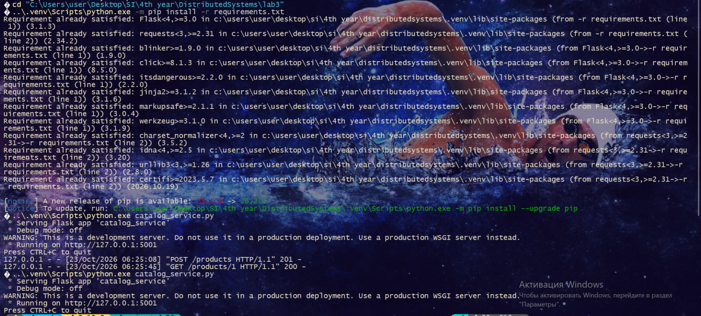
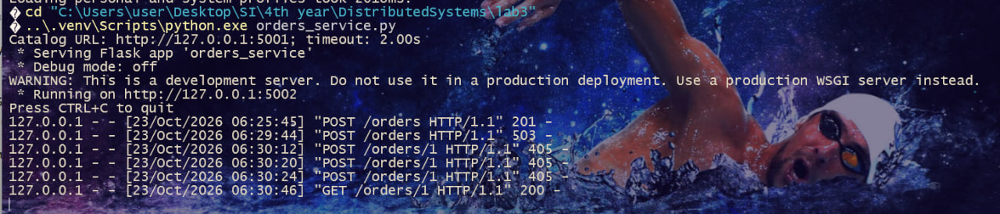
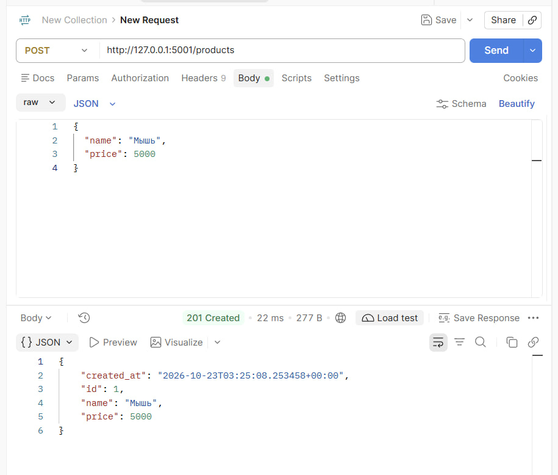
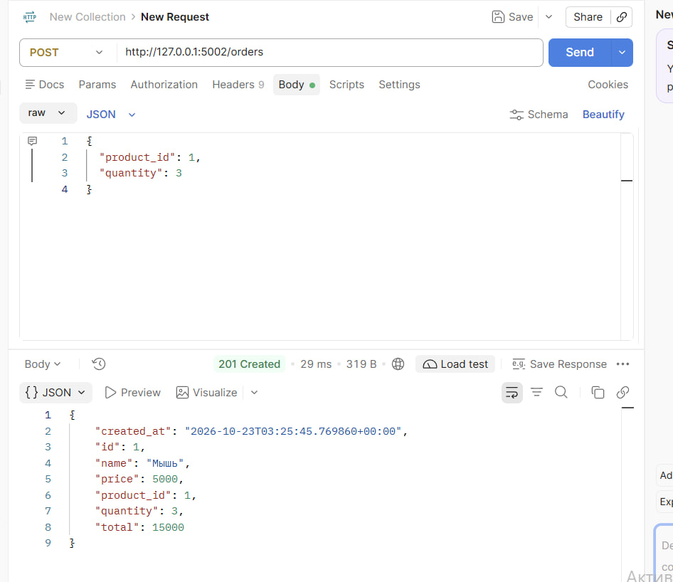
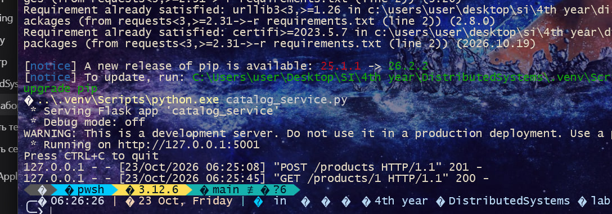
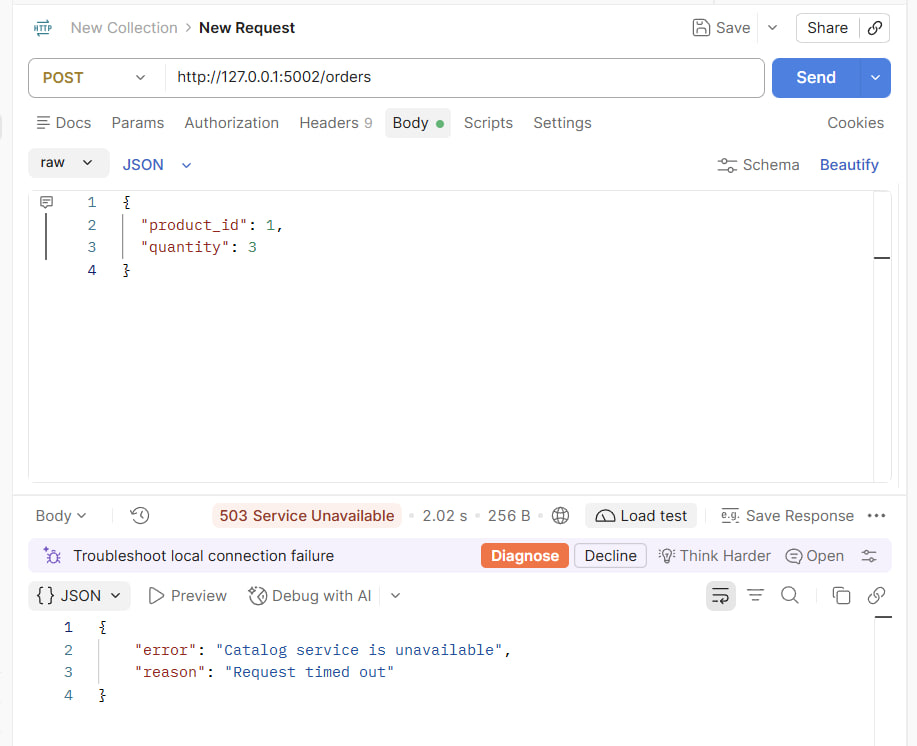
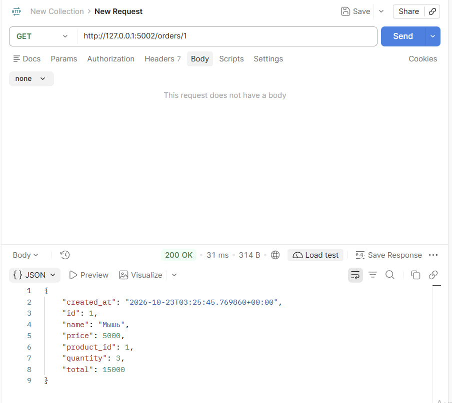

# Lab 3 — REST API and Two Services


The project contains two independent multithreaded Flask processes. Catalog
stores products. Orders requests product data from Catalog over HTTP and stores
a complete order snapshot in memory.

## Files

- `catalog_service.py` — Catalog on port 5001.
- `orders_service.py` — Orders on port 5002.
- `requirements.txt` — Python dependencies.
- `screenshots/` — evidence of the required checks.


## Install

```powershell
cd lab3
python -m venv .venv
.\.venv\Scripts\Activate.ps1
python -m pip install -r requirements.txt
```

## Run the two services manually

Terminal 1:

Open both terminals in `lab3` and activate `.venv` in each before running Python.

```powershell
python catalog_service.py --host 127.0.0.1 --port 5001
```

Terminal 2:

```powershell
python orders_service.py --host 127.0.0.1 --port 5002 --catalog-url http://127.0.0.1:5001 --catalog-timeout 2
```

Both programs use `threaded=True`, so Flask may process different requests in
different threads. `products_lock` and `orders_lock` protect the shared
dictionaries and id counters.

## Endpoints

- `POST http://127.0.0.1:5001/products` — create a product.
- `GET http://127.0.0.1:5001/products/<id>` — retrieve a product.
- `POST http://127.0.0.1:5002/orders` — create an order.
- `GET http://127.0.0.1:5002/orders/<id>` — retrieve a saved order.

## Execution and results

### 1. Setup and startup

Dependencies were installed from `requirements.txt`. Two separate Flask processes were started in two terminals: Catalog on port **5001** and Orders on port **5002**. Data is stored in memory. HTTP requests from Orders to Catalog use a **2-second timeout**. The checks were performed manually in Postman.

Dependency installation and Catalog startup (the screenshot also includes a later restart):



Orders startup and request logs:



### 2. Check with both services running

A product named “Мышь” (Mouse), priced at **5000**, was created using `POST http://127.0.0.1:5001/products`. Catalog returned **201 Created** and assigned product ID **1**.



Next, `POST http://127.0.0.1:5002/orders` was sent with `product_id: 1` and `quantity: 3`. Orders fetched the product from Catalog over HTTP, saved its name and price in the order, and calculated the total: **5000 × 3 = 15000**. The response was **201 Created**.



### 3. Check with Catalog stopped

The Catalog process was stopped using `Ctrl+C`. Its logs show the product creation and the `GET /products/1` request made by Orders when creating the order.



When `POST http://127.0.0.1:5002/orders` was repeated, Orders returned **503 Service Unavailable** with a JSON error: `Catalog service is unavailable`, with the reason `Request timed out`. The request completed in approximately **2 seconds**, and Orders continued running.



### 4. Retrieving the saved order

With Catalog still stopped, `GET http://127.0.0.1:5002/orders/1` was sent. Orders returned **200 OK** and the previously saved order: “Мышь”, price **5000**, quantity **3**, and total **15000**. Retrieving the order does not require another request to Catalog.



All three required checks passed. Restarting either service clears the data stored in that service's memory.

## Timeout and saved data

Orders calls Catalog using `requests.get(..., timeout=2.0)`. This limits connection and socket read waiting. Connection failures and timeouts are handled by returning HTTP 503 with a JSON error, while Orders keeps running.

Each order stores a copy of the product name and price. Reading a saved order does not call Catalog. Restarting a service clears its in-memory data.

## AI usage

AI helped explain the assignment instructions, write the code with the student, check it for errors, and verify that the completed work met all assignment requirements.
